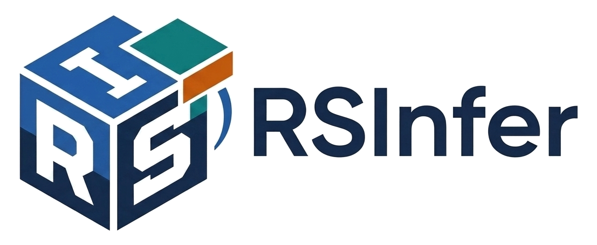
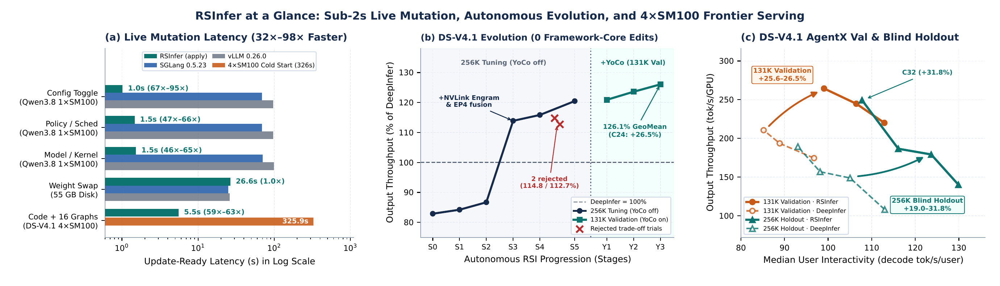
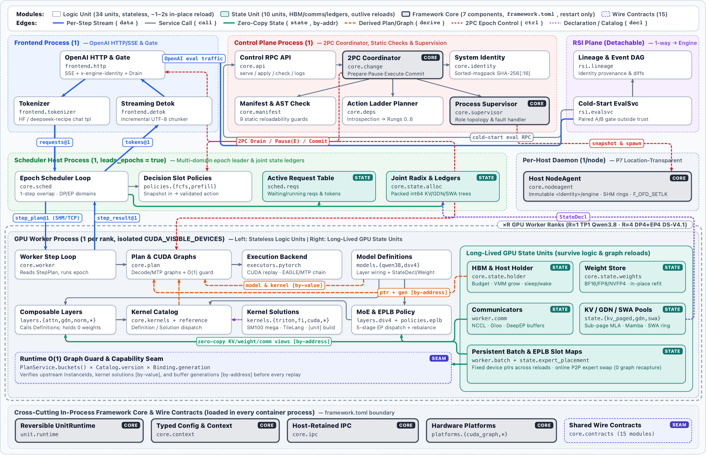
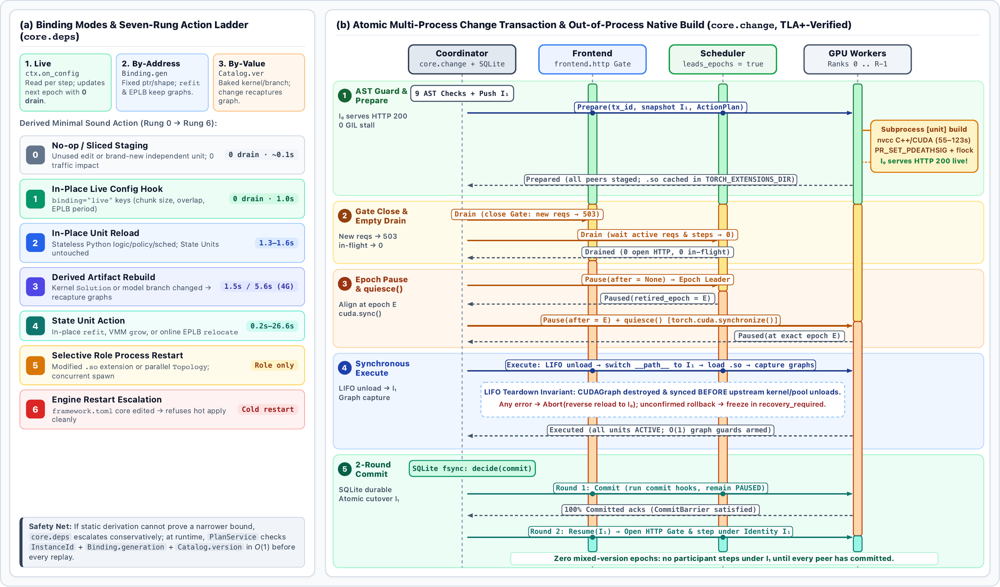
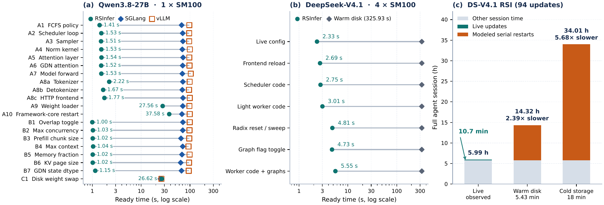
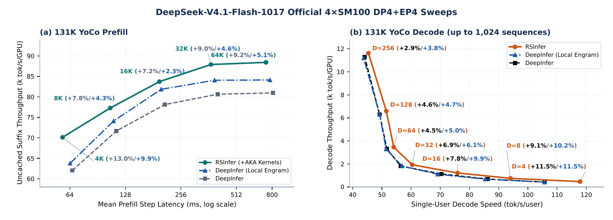
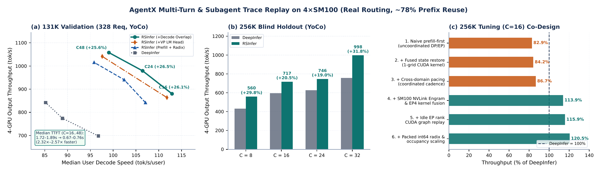
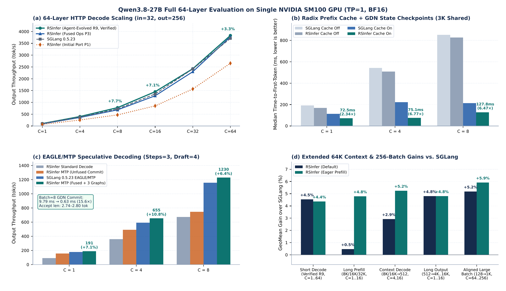
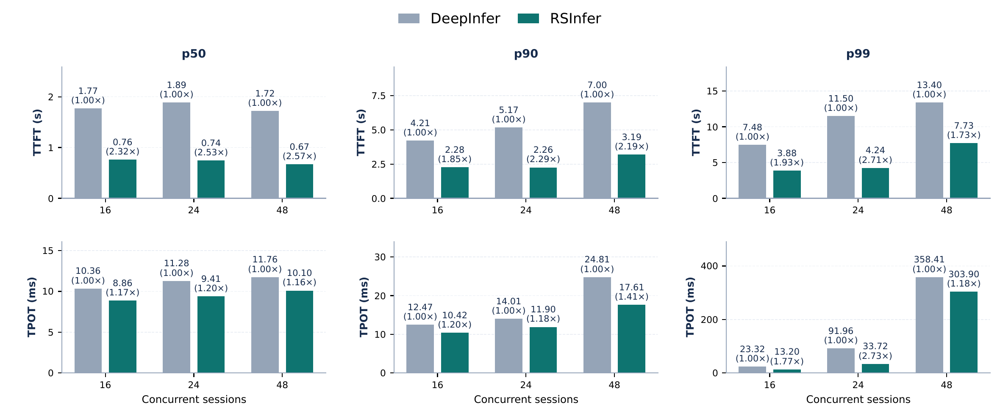
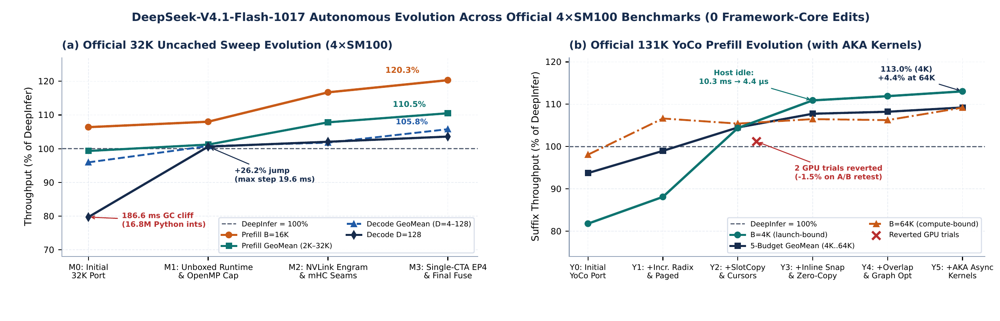

<div align="center">



### An RSI-Native LLM Serving Engine for Live, Compositional, and Safe Self-Improvement

**Rethinking Inference Infrastructure When AI Agents Become the System Engineers**

[English](README.md) | [简体中文](README_zh.md)

[](doc/RSInfer_Technical_Report.pdf)
[](doc/quickstart.md)
[](tests/framework/formal/README.md)
[](pyproject.toml)
[](LICENSE)

</div>

---

**RSInfer** is a production-grade LLM serving engine built from first principles for **Recursive Self-Improvement (RSI)**. AI agents and systems engineers can continuously profile, rewrite, and optimize kernels, schedulers, and serving stacks directly on live GPU engines without paying cold-start taxes or risking silent corruption.



### Key Highlights

- **Microkernel Design, Everything Is a Hot-Pluggable Unit:** RSInfer keeps a minimal, domain-agnostic microkernel core (`engine/framework.toml`) separate from all serving logic. Schedulers, models, attention backends, and kernels are packaged as hot-reloadable **Logic Units**, while weights, KV pools, and NCCL communicators live in long-lived **State Units**. For any code or config edit, `core.deps` automatically derives the **minimal safe change set** (which units reload, which CUDA graphs recapture, and whether traffic must drain), allowing live updates to finish in seconds while GPU state stays resident.
- **32×–98× Faster Live Mutations:** In-place code and configuration updates finish in **1.0–2.2 s** on 1×SM100 (`Qwen3.8-27B`) vs. 64–104 s restarts in SGLang/vLLM. On 4×SM100 serving `DeepSeek-V4.1-Flash-1017` (552B MoE + 196B Engram, 475.2 GiB checkpoint), an autonomous agent ran **95 live updates with zero restarts** in 6 hours at **5.18 s** median code-reload latency (**63×–216×** faster than cold boots), saving **8–31 hours** in a single session.
- **Zero Framework-Core Edits During Autonomous RSI:** All autonomous optimization trajectories (11 rounds and ~75 live `apply`s on `Qwen3.8-27B`, plus all three `DeepSeek-V4.1-Flash-1017` benchmark campaigns including 95 live `apply`s on 4×SM100) landed entirely inside reloadable **Units**, with **zero edits** to the microkernel core (`engine/framework.toml`).
- **Frontier SM100 Serving Performance:** On 1×SM100 `Qwen3.8-27B`, agent-evolved RSInfer reaches **104.5%** of native SGLang decode throughput, **up to 2.95×** lower prefix-cached TTFT, and **+6.4–10.8%** higher EAGLE/MTP throughput. On 4×SM100 `DeepSeek-V4.1-Flash-1017`, RSInfer outperforms DeepInfer and DeepInfer (Local Engram) at every point of the official 131K sweep (up to **+13.0% / +9.9%** prefill and **+11.5%** decode), and on real multi-turn **AgentX** traces delivers **+25.6–26.5%** output throughput on the 131K validation split and **+19.0–31.8%** on the 256K blind holdout while cutting median and P99 TTFT by up to **4.1×** and **2.7×**.
- **Formally Verified & Audit-Proof:** Distributed commit, rollback, and incarnation protocols are checked by **4 TLA+ specifications** (43 TLC configurations, 17 bug mutants, 14 witnesses) paired with **59 Python trace-replay tests**, runtime `O(1)` CUDA Graph guards, and clean cold-start evaluation gates.

> **Asynchronous Kernel Research via AKA:** RSInfer delegates isolated operator search to [Atrex Kernel Agent (AKA)](third_party) (upstream development on [aka-for-rsi](https://github.com/alibaba/atrex-kernel-agent/tree/aka-for-rsi)). See the [AKA Optimization Guide](.claude/skills/optimize-kernels-with-aka/SKILL.md) for setup, task submission, and candidate integration.

---

## Motivation

More and more work asks AI agents to improve AI infrastructure itself: write faster kernels, redesign scheduling policies, and evolve entire inference engines. Today's serving engines (vLLM, SGLang, DeepInfer, etc.) were not designed for this:

- **Every tiny edit forces a full restart.** Changing a 10-line scheduling policy or a kernel wrapper tears down processes, re-initializes CUDA and communicators, reloads tens to hundreds of gigabytes of weights (1–20 minutes), and recaptures CUDA graphs, throttling every single agent iteration.
- **Nobody knows the true blast radius.** Swapping a kernel without recapturing CUDA graphs, or replacing weights without invalidating cached scales or KV states, silently produces wrong outputs with zero runtime exceptions.
- **In-situ measurements are untrustworthy.** Numbers benchmarked inside a repeatedly mutated process drift with mutation history and allocator fragmentation; unconstrained agents can also subtly game benchmarks (e.g., skipping EOS checks or slicing the vocabulary).
- **Improvements do not compose.** Without deterministic system identity and atomic transitions, one optimization rarely serves as a reliable, verifiable starting point for the next.

## Mission

Build an inference engine **architected from the ground up to "safely change anything"**:

- Any change can be safely applied and rolled back, and honestly reports what it actually did;
- Any result traces back to an exact cryptographic system version (`Identity`);
- Promotion evaluations run outside the mutated system on clean, cold-started instances;
- Accepted improvements become reliable new baselines that can be branched, merged, and stacked.

**Above all, RSInfer is first and foremost a standalone, OpenAI-compatible serving engine you can deploy just like vLLM or SGLang; everything for outer-loop self-improvement is a detachable plugin.**

---

## Core Ideas & Architecture

- **Every module is a "Unit."** A Unit is the smallest unit of management and hot-reloading; OS processes are merely containers for units. Change a scheduling policy, and only that unit reloads, with no process restarts.
- **A domain-agnostic microkernel core.** The framework core (`engine/framework.toml`, ~10K LoC, 24.6% of `engine/`) has no built-in concept of tokens, schedulers, KV caches, or TP. All serving capabilities live in **44 hot-reloadable Units**, composed cleanly like in-process microservices.
- **Long-lived State Units outlive stateless Logic Units.** 10 **State Units** hold GPU HBM pools, weights, NCCL communicators, and ledgers across reloads; 34 **Logic Units** (models, layers, kernels, schedulers, frontends) reload in seconds without dropping hundreds of gigabytes of weights or KV cache.
- **The framework derives the exact cost of every edit.** From *what changed*, `core.deps` automatically computes which units must reload, which CUDA graphs must be recaptured, and whether traffic must drain, touching only what is truly affected.



*Interactive architecture map (click any unit to inspect its responsibilities, edges, and change scenarios): [doc/modules.html](doc/modules.html).*

### Live Change Protocol & Action Ladder

RSInfer models inter-unit dependencies with six edge types (`data`, `call`, `state`, `derive`, `ctrl`, `decl`) and three binding modes (**Live**, **By-Address**, **By-Value**). Given any workspace or configuration `ChangeSet`, `core.deps` maps it onto the minimal sound rung of a **7-rung Action Ladder (Rung 0–6)**, compiles native C++/CUDA extensions asynchronously in background subprocesses during `Prepare` while live traffic continues serving HTTP 200, enforces an `O(1)` three-part CUDA Graph guard before every replay, and commits or rolls back atomically across distributed GPU workers via a TLA+-verified two-round commit barrier.



### Seven Expressiveness Principles (P1–P7)

To let one unchanged unit contract span single-GPU hybrid linear-attention models and multi-GPU sparse MoE architectures, RSInfer enforces seven architectural invariants across all seams:

| Principle | Invariant |
|---|---|
| **P1: Data-Driven Description** | Parallel meshes, placement topologies, weight formats (`WeightDecl`), and per-layer cache layouts (`StateDecl`: sub-page ratios, byte shapes, lifetimes) are expressed as declarative data. |
| **P2: Open Records** | Per-step cross-process payloads (`StepPlan` / `StepResult`) are extensible columnar binary maps (`dict[str, bytes]`), enabling MTP speculation or YoCo replay with zero transport schema edits. |
| **P3: Rank-Indexed Interfaces** | Execution and ledger interfaces are indexed per rank and scheduling domain (`sched.domains`), unifying TP (`comm.size=1` / identical plans) and heterogeneous `DP4 + EP4`. |
| **P4: Capability Declarations** | Units statically declare state actions (`drain`, `refit`), graph capturability, native libraries, and out-of-process `[unit] build` hooks in `unit.toml`. |
| **P5: Joint Constraint Protocols** | Multi-pool admission and prefix reuse follow a "propose constraints → intersect" protocol across paged KV, Mamba/GDN recurrent slots, and SWA ring buffers. |
| **P6: Unified ChangeSet** | Agent code patches, live config toggles, startup, `sleep`/`wake`, and runtime reconfigurations (such as online EPLB) all flow through one transactional pipeline. |
| **P7: Strict Location Transparency** | No framework or unit module may hardcode `localhost`, OS PIDs, or host-local paths in endpoint IDs (`ProcId = (HostId, role, index)`), statically enforced in CI. |

---

## Empirical Highlights

### 1. Live Mutation Latency & Autonomous Session Telemetry



| Model & Scale | Mutation Scenario | RSInfer Median | Baseline / Cold Boot | Speedup |
|---|---|---:|---:|---|
| **Qwen3.8-27B** (1×SM100, 55.6 GB) | Toggle live config (`sched.overlap`) | **1.00 s** | 71.7 s (SGLang) / 98.8 s (vLLM) | **71× / 98×** (Rung 1, 0 drain) |
| **Qwen3.8-27B** (1×SM100, 55.6 GB) | Edit policy / scheduler / model / kernel | **1.41–1.54 s** | 67.4–72.2 s (SG) / 96.9–103.8 s (vLLM) | **45×–69×** (Rung 2, weights kept) |
| **Qwen3.8-27B** (1×SM100, 55.6 GB) | Swap 55 GB disk weights (`refit`) | **26.62 s** | 24.8 s (SG) / 26.0 s (vLLM) | **1.0×** (Rung 4, parity w/ RPC) |
| **DS-V4.1** (4×SM100, 475.2 GiB) | Live config / sched / light worker code | **2.33–3.01 s** | 325.9 s warm (18–20 min cold FS) | **108×–140×** (9–11 ms pause) |
| **DS-V4.1** (4×SM100, 475.2 GiB) | Worker code + CUDA ext + 16 Graphs | **5.55 s** | 325.9 s warm (18–20 min cold FS) | **59×** (**195×–216×** vs. cold FS) |
| **DS-V4.1** (6 h autonomous session) | **95 live `apply`s, 0 restarts** | **10.7 min total** | 8.5 h warm / 28–31 h cold restarts | **2.39×–6.20×** total session speedup |

### 2. Frontier Serving Performance on 4×SM100 (`DeepSeek-V4.1-Flash-1017`, `DP4+EP4`)

RSInfer beats both stock **DeepInfer** and strengthened **DeepInfer (Local Engram)** at every point of the official 131K YoCo prefill and steady-state decode sweeps, and generalizes cleanly to real multi-turn + subagent **AgentX** traces (`~78%` prefix reuse, real routing, `256/256` bit-exact greedy parity):





| Benchmark (`DeepSeek-V4.1-Flash-1017`, 4×SM100 `DP4+EP4`) | RSInfer | vs. DeepInfer | vs. DeepInfer (Local Engram) |
|---|---:|---:|---:|
| **Official 131K YoCo Prefill** (`4K–64K`, +AKA Kernels) | **70,128 → 88,438 tok/s/GPU** | **+7.2–13.0%** | **+2.3–9.9%** |
| **Official 131K YoCo Decode** (`D=4..256`/GPU, up to 1,024 seqs) | **471.5 → 11,621.1 tok/s/GPU** | **+2.9–11.5%** | **+3.8–11.5%** |
| **AgentX 131K Validation** (`C=16/24/48`, 328 reqs) | **880 / 979 / 1,058 out tok/s** | **+25.6–26.5%** (P50 TTFT **2.32×–2.57×** faster) | — |
| **AgentX 256K Blind Holdout** (`C=8..32`, 256 reqs) | **560 → 998 out tok/s** (119.4K total) | **+19.0–31.8%** (P50 TTFT **1.74×–4.05×** faster) | — |

<details>
<summary><b>More Results: Qwen3.8-27B on 1×SM100, AgentX Percentile Latencies, DS-V4.1 Evolution Trajectories, and TLA+ Verification</b></summary>

#### `Qwen3.8-27B` Full 64-Layer Evaluation on 1×SM100 vs. SGLang 0.5.23

- **Verified Agent-Evolved Decode (`R9`, self-check ON):** **104.54%** GeoMean decode throughput vs. SGLang (+7.7% at `C=8`, +7.1% at `C=16`), with short-prompt TTFT down to **17.1 ms** (2.90× faster than SGLang's 49.7 ms).
- **Radix Prefix Caching + GDN Snapshots (3K shared prefix):** Median TTFT drops to **72.5 / 75.1 / 127.8 ms** at `C=1/4/8` (**2.34×–6.77×** over uncached, up to **2.95×** faster than cache-enabled SGLang).
- **EAGLE/MTP Speculation:** Fused Triton GDN state commit (`9.79 → 0.63 ms`) + 3 CUDA Graph families reach **191 / 655 / 1,230 tok/s** (**+7.1% / +10.8% / +6.4%** over native SGLang MTP).



#### AgentX 131K Validation TTFT & TPOT Percentiles (`p50 / p90 / p99`)



#### Autonomous `DeepSeek-V4.1` Evolution Trajectories (0 Framework-Core Edits)



#### Bounded TLA+ Formal Verification Suite (`tests/framework/formal/`)

- **4 TLA+ specifications** (`Transaction.tla`, `Participant.tla`, `SequentialTx.tla`, `Incarnation.tla`; 450 LoC) checked by SHA-256-pinned TLC 1.7.4 across **43 configurations** (12 normal models covering 4,743 states, **17 bug mutants**, **14 reachability witnesses**) + **59 Python trace-replay & in-memory mutant tests** against real runtime handlers.

</details>

---

## Quick Start

For a full hands-on walkthrough (live code hot-reload & rollback demo, process log locations, `sleep`/`wake`, and troubleshooting), see **[doc/quickstart.md](doc/quickstart.md)**.

### 1. One-Command 4×SM100 Serving & Live Hot-Reload (`deploy/`)

`deploy/serve_ds1017.sh` automatically aligns `CUDA_HOME`, `nvcc`, `LD_LIBRARY_PATH`, `TRITON_PTXAS_PATH`, and `nvidia.cu13` `CPATH` to the active Python's `torch.version.cuda`:

```bash
source /path/to/venv/bin/activate
export RSINFER_MODEL=/path/to/DeepSeek-V4.1-Flash-1017

# Start 4xSM100 DS1017 (DP4/EP4, detached, port 8000, run dir run/rsinfer)
./deploy/serve_ds1017.sh serve --gpus 0,1,2,3
./deploy/serve_ds1017.sh status

# Streamed chat / completions or standard OpenAI HTTP API
./deploy/serve_ds1017.sh chat "Explain live hot-reloading in three sentences." --max-tokens 128
curl -s http://127.0.0.1:8000/v1/chat/completions \
  -H 'Content-Type: application/json' \
  -d '{"model":"DeepSeek-V4.1-Flash","messages":[{"role":"user","content":"1+1=?"}],"max_tokens":32,"temperature":0}'

# Live-apply config or code edits without restarting or reloading weights
./deploy/serve_ds1017.sh control apply --config '{"sched.overlap": false}' --dry-run
./deploy/serve_ds1017.sh control check --source .
./deploy/serve_ds1017.sh control apply --source . --dry-run
./deploy/serve_ds1017.sh control apply --source . --intent "describe your change"

# Inspect per-process logs (<run>/host-a/snapshots/.run/<role>-<index>-<seq>/log)
ls run/rsinfer/host-a/snapshots/.run/*/log

# Temporarily release / restore GPU memory, or stop the engine
./deploy/serve_ds1017.sh sleep --wait-empty
./deploy/serve_ds1017.sh wake
./deploy/serve_ds1017.sh stop
```

For general single-host usage (`Qwen3.8-27B`, single-GPU, or CPU debugging via `deploy/rsinfer.py`), see [deploy/README.md](deploy/README.md).

### 2. Local One-Command GPU Benchmarks (`tests/gpu/ds1017_bench/`)

Benchmark scripts automatically stage temporary probes into disposable `.runs/bench-*` directories (cleaned on exit), keeping the git working tree untouched:

```bash
# Official 131K YoCo Prefill (64K point; omit numbers for full 4K–64K sweep)
./tests/gpu/ds1017_bench/run_rsinfer_official.sh prefill --gpus 0,1,2,3 65536

# Official 131K YoCo Decode (D=256/GPU; omit numbers for full 4–256 sweep)
./tests/gpu/ds1017_bench/run_rsinfer_official.sh decode  --gpus 0,1,2,3 256

# AgentX multi-turn replay benchmark
./tests/gpu/ds1017_bench/run_agentx.sh run-rsinfer --gpus 0,1,2,3 /path/to/agentx_eval 32
```

See [tests/gpu/ds1017_bench/README.md](tests/gpu/ds1017_bench/README.md) for dataset preparation and full options.

### 3. Local Type Checking, Unit Tests & TLA+ Formal Verification

```bash
uv sync --python 3.12 --extra cpu
uv run pyright
OMP_NUM_THREADS=1 uv run pytest -n 8
uv run python tests/framework/formal/run.py --bootstrap --replay
```

---

## Develop & Evolve: A Tree of RSI Branches

`master` is intentionally kept lean as a **general-purpose base plus two end-to-end reference models** (`Qwen3.8-27B` and `DeepSeek-V4.1-Flash-1017`). Optimal kernels, batching policies, and memory layouts depend tightly on the specific `(model, hardware, workload)` tuple. Pushing every model-specific tweak and agent-discovered heuristic into a single branch would turn `master` into a bloated monolith that slows everyone down.

Our development model is a **growing tree of specialized RSI branches**. If you want to onboard a new model or optimize for your own hardware and traffic, fork `master` and run your own RSI loop on a dedicated branch, following the same pattern as our own optimization branches in this repository:

```text
master  (general microkernel base + Qwen3.8 & DS-V4.1 examples + shared serving infra)
 ├── optimized-deepinfer     # Reference RSI branch: AKA SM100 prefill kernels (--aka-profile / --aka-warmup)
 ├── exp/agentx-opt          # Reference RSI branch: AgentX concurrency (vocab-parallel LM head, multi-stream overlap, occupancy scheduling)
 ├── your-fork / model-X     # Community branch: onboard Model X and evolve on your target GPUs
 └── your-fork / workload-Y  # Community branch: tailor schedulers and kernels to your production traffic
```

### What Lives in Your Branch vs. `master`

| Scope | Where it belongs | Examples |
|---|---|---|
| **Model onboarding & workload-specific RSI** | **Your fork / RSI branch** | Adding a new model architecture or checkpoint variant; hardware-specific Triton, TileLang, CUDA, or AKA kernels; traffic-tuned scheduling, overlap, and batching heuristics |
| **Shared serving infrastructure** | **Merged into `master`** | Major foundational capabilities so the community avoids duplicating work: **Prefill/Decode (PD) disaggregation**, **multi-node serving (`DP16+EP16`)**, **elastic EP & fault containment**, framework-core fixes, formal verification, and shared unit abstractions |

As major trunk capabilities (such as PD disaggregation and multi-node support) land on `master`, downstream RSI branches can rebase to pick them up while keeping their specialized optimizations intact.

### Starting Your Own RSI Branch

1. **Fork and branch from `master`.** Use `Qwen3.8-27B` or `DeepSeek-V4.1-Flash-1017` under `engine/models/` and `deploy/models/` as templates for unit boundaries and config wiring.
2. **Iterate live on a running engine.** Start the engine once, point your coding agent (or edit directly) following [.claude/skills/rsinfer/SKILL.md](.claude/skills/rsinfer/SKILL.md) and the optional [AKA Optimization Guide](.claude/skills/optimize-kernels-with-aka/SKILL.md), and apply changes in seconds via `control apply --source .`. Verify candidate wins on clean cold-started runs before promoting them.
3. **Maintain specialized lineages independently; upstream shared infra.** Keep model- or traffic-specific optimizations in your branch (and feel free to share your RSI lineage), while contributing general-purpose infrastructure improvements back to `master` via PR.

---

## Roadmap & Documentation

### Milestones & Roadmap

| Stage | Status | Scope |
|---|---|---|
| **v0** | ✅ Done | 1×SM100 `Qwen3.8-27B` (64L hybrid GatedDeltaNet + Paged GQA, Radix GDN prefix cache, EAGLE/MTP speculation, full change-protocol verification, autonomous evolution past SGLang) |
| **v1** | ✅ Done | 4×SM100 `DeepSeek-V4.1-Flash-1017` (`DP4+EP4`, 4-stream mHC, Sparse MLA + SWA + YoCo, 384+32 NVFP4 MoE + online EPLB, NVLink Engram, AKA kernels, surpassing DeepInfer on 32K/131K sweeps & AgentX 131K/256K) |
| **v2** | 🚧 Roadmap | Elastic EP rank resizing & intra-group fault containment, multi-node `DP16+EP16` & disaggregated Prefill/Decode, standalone `rsi.evalsvc` / `rsi.lineage` daemon |

### Documentation Map

- [doc/RSInfer_Technical_Report.pdf](doc/RSInfer_Technical_Report.pdf): Full Technical Report (architecture, formal verification, model evolution, SM100 evaluation, and dogfooding bug taxonomy).
- [doc/quickstart.md](doc/quickstart.md): Step-by-step serve, OpenAI API, live hot-reload demo, log inspection, and benchmark guide.
- [doc/modules.html](doc/modules.html): Interactive unit architecture map, edge rules, and change scenarios (design source of truth).
- [doc/specs/](doc/specs/): Specifications for the 7 framework-core components, change protocol, CUDA graphs, prefix caching, MTP, and DS1017.
- [deploy/README.md](deploy/README.md): Complete `deploy/rsinfer.py` CLI reference (`serve`, `control`, `sleep`/`wake`, `checkpoint`).
- [.claude/skills/rsinfer/SKILL.md](.claude/skills/rsinfer/SKILL.md): Repository directory map and agent workflow for live-engine development & `# PROBE` debugging.

---

## Citation

If you find RSInfer useful in your research or systems work, please cite our technical report:

```bibtex
@techreport{wu2026rsinfer,
  title   = {RSInfer: An RSI-Native LLM Serving Engine for Live, Compositional, and Safe Self-Improvement},
  author  = {Tianyuan Wu and Wei Gao and Ruibo Fan and Chaokun Chang and Hanfeng Lu and Yuechen Tao and Yinghao Yu and Wei Wang},
  institution = {HKUST and Alibaba Group},
  year    = {2026},
  url     = {https://github.com/open-agent-infra/RSInfer}
}
```

## License & Acknowledgments

RSInfer is released under the [Apache License 2.0](LICENSE). Third-party adapted components retain their original upstream licenses in their respective directories (`LICENSE.sglang` and `LICENSE.deepinfer` under Apache-2.0; `LICENSE.mini-sglang` and `LICENSE.deepseek` under MIT).

We gratefully acknowledge the open-source projects whose kernels, abstractions, and evaluation ecosystems informed or integrate with RSInfer, including [SGLang](https://github.com/sgl-project/sglang), [FlashInfer](https://github.com/flashinfer-ai/flashinfer), [TileLang](https://github.com/tile-ai/tilelang), [DeepGEMM](https://github.com/deepseek-ai/DeepGEMM), [FlashMLA](https://github.com/deepseek-ai/FlashMLA), [DeepInfer](https://github.com/deepseek-ai/DeepInfer), and [Atrex Kernel Agent (AKA)](https://github.com/alibaba/atrex-kernel-agent).
