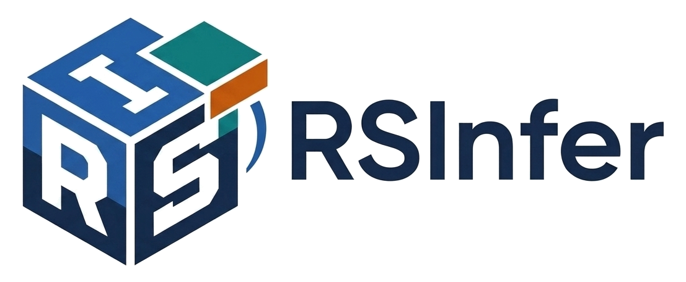
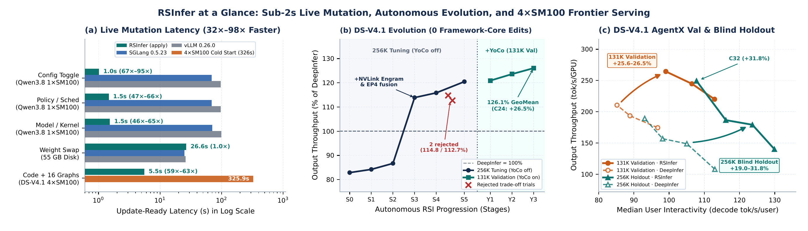
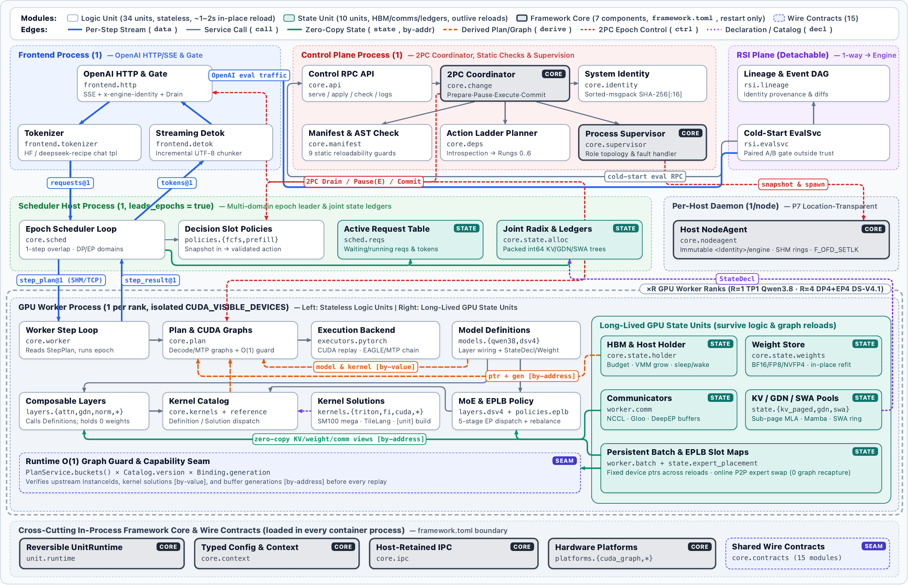
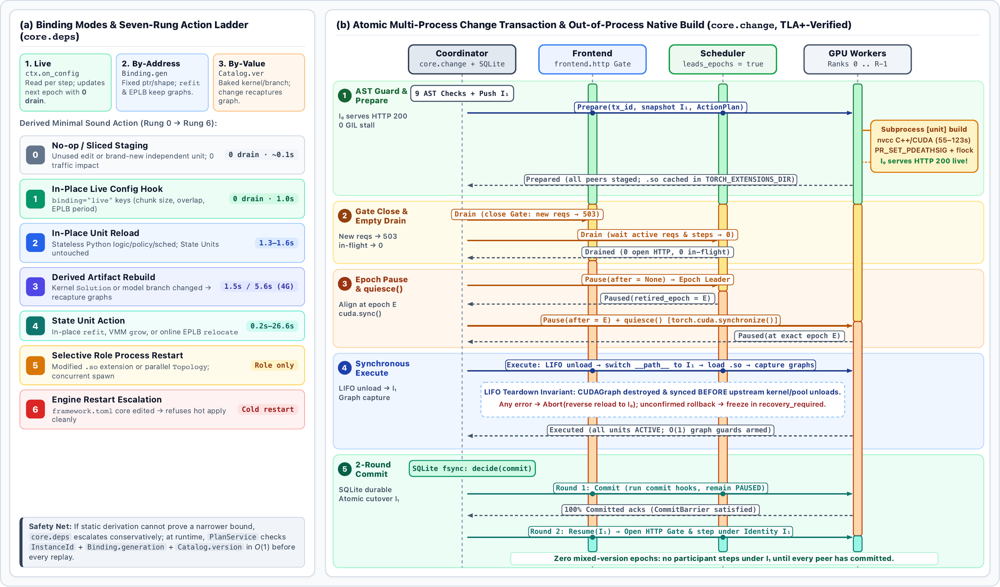
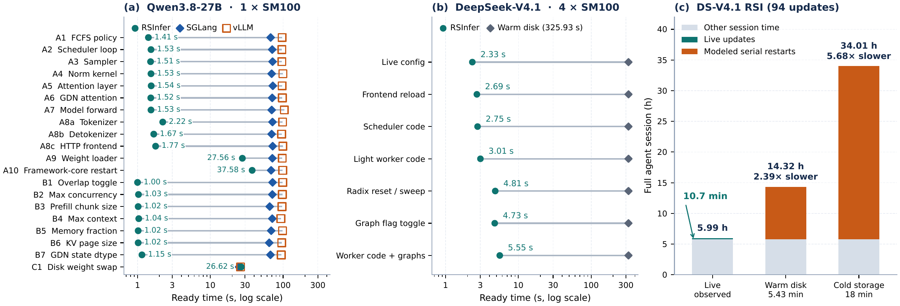
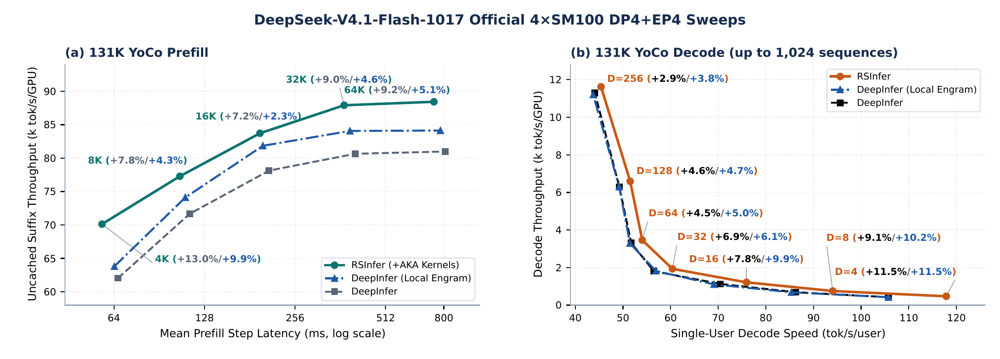
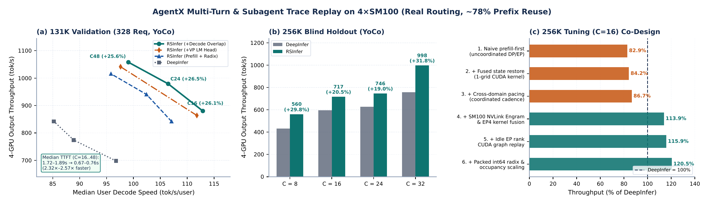
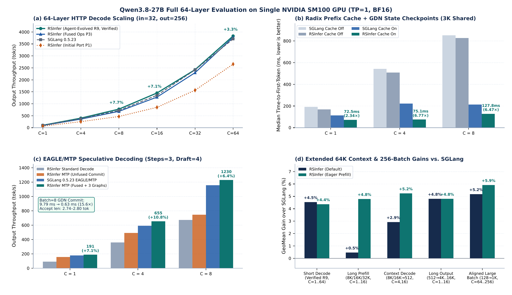
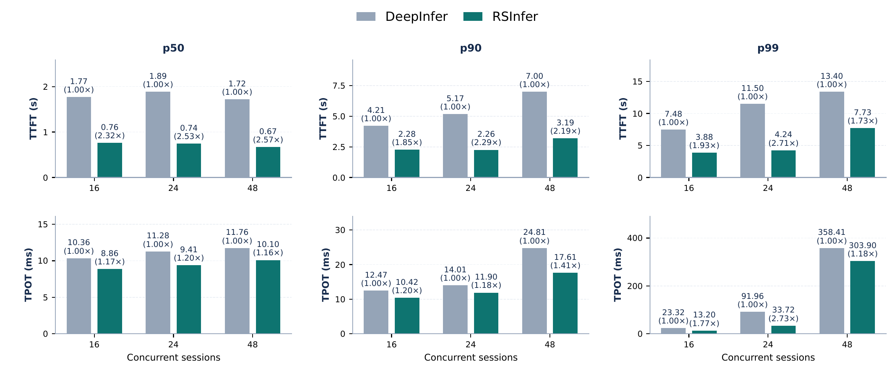
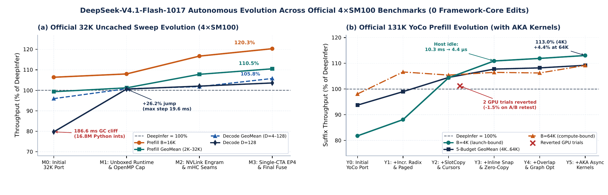

<div align="center">



### 面向“AI 自我改进”的原生大模型推理引擎

**当 AI Agent 成为系统工程师，重新设计推理基础设施**

[English](README.md) | [简体中文](README_zh.md)


[](#快速上手)
[](tests/framework/formal/README.md)
[](pyproject.toml)
[](LICENSE)

</div>

**Ascend 910C / CANN** · [部署、调优与验证文档](doc/README.md)

---

**RSInfer** 是一个从第一性原理出发、为 **AI 递归自我改进（Recursive Self-Improvement, RSI）** 而设计的生产级大模型推理引擎。它让 AI Agent 与系统工程师可以在运行中的多卡 GPU 引擎上安全、秒级地热改算子、调度器与模型层，摆脱动辄数十分钟的冷启动税与静默状态损坏风险，同时在前沿硬件上保持甚至超越静态定制引擎的吞吐与延迟表现。



### 核心亮点

- **微内核架构，“一切皆可热插拔单元”：** RSInfer 将极简、领域无关的微内核框架本体（`engine/framework.toml`）与所有推理能力彻底解耦。调度策略、模型定义、注意力后端与算子全部封装为可热重载的**逻辑单元**，权重、KV 池与 NCCL 通信组则常驻在长寿命**状态单元**中。面对任意源码或配置改动，`core.deps` 会自动推导出**最小安全变更集合**（需要重载的单元、需要重录的 CUDA Graph 以及是否排空流量），在不重启进程、不丢显存的前提下完成秒级热更新。
- **32×–98× 更快的热变更：** 单张 SM100 跑 `Qwen3.8-27B` 时，原地热改代码/配置仅需 **1.0–2.2 秒**（对比 SGLang/vLLM 64–104 秒重启）。在 4×SM100 跑 `DeepSeek-V4.1-Flash-1017`（552B MoE + 196B Engram，475.2 GiB 权重）的 6 小时自主优化会话中，Agent 完成 **95 次热更新、0 次重启**，代码热重载中位耗时 **5.18 秒**（比冷启动快 **63×–216×**），单场会话节省 **8–31 小时**重启等待。
- **自主 RSI 全程零框架本体改动：** 无论是 `Qwen3.8-27B` 上 11 轮自主演化（约 75 次热 `apply`），还是 4×SM100 `DeepSeek-V4.1-Flash-1017` 上三条基准线的数十次连续优化（含单场 95 次热更新），所有改进全部落在可热重载的**单元（Unit）**中，**0 行改动**触及领域无关的微内核框架本体（`engine/framework.toml`）。
- **前沿 SM100 实测性能：** 单卡 `Qwen3.8-27B` 上，Agent 演化后的 RSInfer 达到原生 SGLang Decode 吞吐的 **104.5%**、前缀缓存 TTFT 最高降低 **2.95×**、EAGLE/MTP 投机解码快 **+6.4–10.8%**；4×SM100 `DeepSeek-V4.1-Flash-1017` 上，官方 131K Prefill 与 Decode 扫描全档位超越原版及本地 Engram 版 DeepInfer，其中 Prefill 最高提升 **+13.0% / +9.9%**、Decode 最高提升 **+11.5%**；在真实多轮 **AgentX** 轨迹上，131K 验证集输出吞吐提升 **+25.6–26.5%**，256K 盲测集提升 **+19.0–31.8%**，中位与 P99 TTFT 最高缩短 **4.1×** 与 **2.7×**。
- **形式化验证与可信评测：** 分布式变更、回滚与进程代次协议经 **4 份 TLA+ 规约**（43 组 TLC 配置、17 个故障变异体、14 个可达性见证）及 **59 个真实实现回放测试**校验；叠加运行时 `O(1)` CUDA Graph 守卫与外置冷启动真值评测门禁。

> **算子优化开发工具（AKA）：** RSInfer 使用 Atrex Kernel Agent（AKA）异步委托单算子深度优化。在 [third_party](third_party) 中点击 `aka` 可查看当前版本使用的确切提交，后续开发在上游 [aka-for-rsi 分支](https://github.com/alibaba/atrex-kernel-agent/tree/aka-for-rsi) 进行。安装、提交任务和接回候选见 [AKA 使用指南](.claude/skills/optimize-kernels-with-aka/SKILL.md)。

---

## 动机

越来越多的工作在让 AI agent 去改进 AI 基础设施本身：写更快的 kernel、调调度策略、改整个推理引擎的代码。但现在的推理引擎（vLLM、SGLang、DeepInfer 等）不是为这件事设计的：

- **改一点就要重启。** 换一个调度策略、一个 kernel，往往要重启整个引擎，几十秒到二十分钟，agent 的每一轮尝试都被拖慢。
- **改了什么、影响了什么，没人说得清。** 换了 kernel 却没重新录 CUDA graph、换了权重却没重算缩放系数，这类错误会悄悄产生错误结果。
- **结果不可信。** 在反复修改过的进程里测出来的数字，依赖修改的历史；agent 还可能有意无意地“绕过”评测（比如去掉结束符、只算一部分词表）。
- **改进不能叠加。** 一次改进很难成为下一次改进的可靠起点。

## 使命

做一个**架构上就支持“安全地改任何东西”的推理引擎**：

- 任何改动都能安全地应用和回滚，并且如实报告实际做了什么；
- 任何结果都能追溯到确切的系统版本（密码学 `Identity`）；
- 评测在被改的系统之外、在全新启动的实例上进行；
- 被接受的改进可以成为新的起点，可以分支、合并、继续叠加。

**它首先是一个像 vLLM 一样可以部署的推理引擎；支持自我改进的部分是可以拆掉的插件。**

---

## 核心思路与系统架构

- **每个模块都是一个“单元”**，单元是管理和重载的最小单位，进程只是装单元的容器。改了一个调度策略，只重载这一个单元，不重启任何进程。
- **框架本身几乎不带领域概念**：没有内建的“调度器”“KV cache”“TP”，这些全是单元（共 44 个可热重载单元；`engine/framework.toml` 列出的微内核框架本体仅约 1 万行、占 `engine/` 24.6%）。框架只负责把单元拼起来、换下来，像一组微服务拼成一个引擎。
- **持有显存的“状态单元”比逻辑单元活得长**：10 个长寿命**状态单元**持有权重、KV/GDN/SWA 显存池、NCCL 通信组与账本；34 个无状态**逻辑单元**（模型、层、算子、调度器、前端）秒级重载，改代码不会丢掉数百 GiB 的权重和 KV。
- **改动的代价由框架推导**：从“改了什么”算出“哪些单元要重载、哪些 CUDA graph 要重录、要不要排空请求”，只动真正受影响的部分。



*上图展示 RSInfer 的进程与单元全景（白框为无状态逻辑单元，青框为长寿命状态单元，深灰框为微内核框架本体）。可交互版本（点击单元查看职责、边规则与变更场景演示）见 [doc/modules.html](doc/modules.html)。*

### 变更推导与原子热更新协议

RSInfer 用 6 种边类型（`data`、`call`、`state`、`derive`、`ctrl`、`decl`）和 3 种绑定模式（**Live**、**By-Address**、**By-Value**）刻画依赖关系：给定任意源码或配置 `ChangeSet`，`core.deps` 自动推导出 **7 级动作阶梯（Rung 0–6）** 上的最小安全动作；耗时的 C++/CUDA 扩展编译在 `Prepare` 阶段由独立子进程异步完成，引擎照常响应 HTTP 200；每次回放 CUDA Graph 前执行 `O(1)` 三元组守卫；跨多卡 worker 的切换与回滚由经 TLA+ 验证的两轮提交栅栏保证原子性。



### 七条表达力原则（P1–P7）

为保证同一套框架与单元契约既能承载单卡混合线性注意力模型，也能无缝扩展到多卡超稀疏 MoE，RSInfer 在所有接口边界强制执行七条不变量：

| 原则 | 核心约束 |
|---|---|
| **P1：数据驱动描述** | 并行网格、拓扑部署、权重量化排布（`WeightDecl`）与逐层缓存布局（`StateDecl`：子页压缩比、字节形状、生命周期）全为声明式数据，不写死类型。 |
| **P2：开放记录** | 跨进程每步消息（`StepPlan` / `StepResult`）为可扩展列式二进制映射（`dict[str, bytes]`），接入 MTP 投机解码或 YoCo 重放无需修改传输层。 |
| **P3：Rank 索引接口** | 执行与账本接口统一按 rank 与调度域（`sched.domains`）索引，自然统一单卡 TP 与异构 `DP4 + EP4`。 |
| **P4：能力声明** | 单元在 `unit.toml` 静态声明支持的状态动作（`drain`、`refit`）、图可捕获性、原生库与进程外 `[unit] build` 构建钩子。 |
| **P5：联合约束协议** | 多池准入与前缀复用通过“各账本提议约束 → 取交集”完成，统一管理分页 KV、Mamba/GDN 槽位与 SWA 滑窗环。 |
| **P6：统一 ChangeSet** | 代码补丁、在线配置切换、启动、`sleep`/`wake` 与在线 EPLB 重排均走同一条事务变更管线。 |
| **P7：严格位置透明** | 框架与单元代码禁止在端点标识中写死 `localhost`、PID 或本机路径（`ProcId = (HostId, role, index)`），由 CI 静态 AST 扫描强制守护。 |

---

## 实测亮点

### 1. 热更新敏捷度与 4×SM100 自主会话实录



| 模型与规模 | 变更类别 | RSInfer 中位耗时 | 基线 / 冷启动耗时 | 加速比 |
|---|---|---:|---:|---|
| **Qwen3.8-27B**（1×SM100，55.6 GB） | 切换 live 配置（`sched.overlap`） | **1.00 s** | 71.7 s (SGLang) / 98.8 s (vLLM) | **71× / 98×**（Rung 1，0 排空） |
| **Qwen3.8-27B**（1×SM100，55.6 GB） | 改策略 / 调度 / 模型 / 算子 | **1.41–1.54 s** | 67.4–72.2 s (SG) / 96.9–103.8 s (vLLM) | **45×–69×**（Rung 2，保留权重） |
| **Qwen3.8-27B**（1×SM100，55.6 GB） | 磁盘切换 55 GB 权重（`refit`） | **26.62 s** | 24.8 s (SG) / 26.0 s (vLLM) | **1.0×**（Rung 4，与专用 RPC 持平） |
| **DS-V4.1**（4×SM100，475.2 GiB） | live 配置 / 调度 / 轻量 worker 代码 | **2.33–3.01 s** | 325.9 s 热盘（18–20 分钟冷盘） | **108×–140×**（停顿 9–11 ms） |
| **DS-V4.1**（4×SM100，475.2 GiB） | worker 代码 + CUDA 扩展 + 16 张图 | **5.55 s** | 325.9 s 热盘（18–20 分钟冷盘） | **59×**（较冷盘 **195×–216×**） |
| **DS-V4.1**（6 小时自主优化会话） | **95 次热 `apply`，0 次重启** | **总计 10.7 分钟** | 8.5 h 热盘 / 28–31 h 冷盘重启 | 整场会话提速 **2.39×–6.20×** |

### 2. 4×SM100 前沿模型性能（`DeepSeek-V4.1-Flash-1017`，`DP4+EP4`）

RSInfer 在官方 131K YoCo Prefill 与稳态 Decode 全档位超越原版 **DeepInfer** 与增强版 **DeepInfer（Local Engram）**，并在真实多轮 + 子 Agent **AgentX** 轨迹（约 78% 前缀复用、真实路由、`256/256` 贪心逐 token 一致）上实现吞吐与延迟双赢：



**复现图 6 中的 RSInfer 曲线。** 将 `RSINFER_MODEL` 设为 DS1017 权重目录，在四卡机器上切换到对应版本，从仓库根目录运行以下命令。

**(a) Prefill** · `optimized-deepinfer`

先在运行服务的 Python 环境中构建并安装 AKA 算子包，再运行评测。 [评测指南](https://github.com/open-agent-infra/RSInfer/blob/87567b2e2960b3017bbcb5f5cbed9b9778a318ee/tests/gpu/ds1017_bench/README_zh.md)

```bash
git switch --detach 87567b2
uv build --wheel third_party/aka-ds1017-kernels --out-dir dist
python -m pip install --no-deps dist/aka_ds1017_kernels-0.1.0-py3-none-any.whl
./tests/gpu/ds1017_bench/run_rsinfer_official.sh prefill --model "$RSINFER_MODEL" --aka-profile expanded 4096 8192 16384
./tests/gpu/ds1017_bench/run_rsinfer_official.sh prefill --model "$RSINFER_MODEL" --aka-profile validated 32768 65536
```

**(b) Decode** · `exp/agentx-opt`

默认覆盖每卡并发从 4 到 256 的全部七档。 [评测指南](https://github.com/open-agent-infra/RSInfer/blob/9f321de350336549fb594ee127937c3cc443c796/tests/gpu/ds1017_bench/README_zh.md)

```bash
git switch --detach 9f321de
./tests/gpu/ds1017_bench/run_rsinfer_official.sh decode --model "$RSINFER_MODEL"
```



| 评测项（`DeepSeek-V4.1-Flash-1017`，4×SM100 `DP4+EP4`） | RSInfer | 对比 DeepInfer | 对比 DeepInfer (Local Engram) |
|---|---:|---:|---:|
| **官方 131K YoCo Prefill**（`4K–64K`，含 AKA 算子） | **70,128 → 88,438 tok/s/GPU** | **+7.2–13.0%** | **+2.3–9.9%** |
| **官方 131K YoCo Decode**（每卡 `D=4..256`，最高 1,024 并发） | **471.5 → 11,621.1 tok/s/GPU** | **+2.9–11.5%** | **+3.8–11.5%** |
| **AgentX 131K 验证集**（`C=16/24/48`，328 请求） | **880 / 979 / 1,058 out tok/s** | **+25.6–26.5%**（P50 TTFT 快 **2.32×–2.57×**） | — |
| **AgentX 256K 盲测集**（`C=8..32`，256 请求） | **560 → 998 out tok/s**（总吞吐 119.4K） | **+19.0–31.8%**（P50 TTFT 快 **1.74×–4.05×**） | — |

<details>
<summary><b>展开更多实验细节：Qwen3.8-27B 单卡对比、AgentX 分位延迟、DS-V4.1 自主演化曲线与 TLA+ 形式化验证</b></summary>

#### `Qwen3.8-27B` 完整 64 层单卡 SM100 对比 SGLang 0.5.23

- **通过自检的 Agent 自主演化（`R9`，`RSINFER_VERIFY=1`）：** Decode 吞吐几何平均达 SGLang 的 **104.54%**（`C=8` 快 +7.7%、`C=16` 快 +7.1%），短 prompt 首 token 延迟降至 **17.1 ms**（比 SGLang 49.7 ms 快 2.90×）。
- **Radix 前缀缓存 + GDN 状态快照（3K 共享前缀）：** `C=1/4/8` 中位 TTFT 降至 **72.5 / 75.1 / 127.8 ms**（比无缓存快 **2.34×–6.77×**，比开启缓存的 SGLang 最高快 **2.95×**）。
- **EAGLE/MTP 投机解码：** 融合 Triton GDN 状态提交（`9.79 → 0.63 ms`）+ 三套 CUDA Graph，吞吐达 **191 / 655 / 1,230 tok/s**（比原生 SGLang MTP 快 **+7.1% / +10.8% / +6.4%**）。



#### AgentX 131K 验证集 TTFT 与 TPOT 分位延迟（`p50 / p90 / p99`）



#### `DeepSeek-V4.1` 官方基准自主演化轨迹（0 框架本体改动）



#### 有界 TLA+ 形式化验证套件（`tests/framework/formal/`）

- **4 份 TLA+ 规约**（`Transaction.tla`、`Participant.tla`、`SequentialTx.tla`、`Incarnation.tla`，共 450 行）通过固定 SHA-256 的 TLC 1.7.4 遍历 **43 组配置**（12 组正常模型覆盖 4,743 个状态、**17 个故障变异体**、**14 个可达性见证**），并配套 **59 个 Python 轨迹回放与内存变异测试**直接驱动真实代码状态机。

</details>

---

## 快速上手

| 平台或任务 | 操作指南 |
| --- | --- |
| Ascend 910C / CANN | [启动原生 Qwen3、GLM 或 vLLM Ascend 对照](deploy/ascend.md) · [采集性能与验收请求](doc/2026-11-26-ascend-npu-workflow.md) |
| NVIDIA SM100 | [DS1017 启动与热更](doc/quickstart_zh.md) · [DS1017 / AgentX 评测](tests/gpu/ds1017_bench/README_zh.md) |
| 通用单机 CLI 与 CPU 调试 | [部署命令](deploy/README.md#命令) |

### 本地类型检查、测试与 TLA+ 形式化验证

```bash
uv sync --python 3.12 --extra cpu
uv run pyright
OMP_NUM_THREADS=1 uv run pytest -n 8
uv run python tests/framework/formal/run.py --bootstrap --replay
```

---

## 基于 RSInfer 开发与演进：RSI 分支树

`master` 的定位是一个干净的**通用底座加上两个端到端模型样例**（单卡混合架构 `Qwen3.8-27B` 与 4 卡 `DeepSeek-V4.1-Flash-1017`）。极致推理性能高度绑定具体的 `(模型、硬件、业务负载)` 组合，如果把所有模型的特化代码和 Agent 演化出的启发式都堆进同一个分支，`master` 很快会膨胀成难以维护的巨无霸。

我们更希望围绕 `master` 长出一棵**分支树**：想接入新模型，或针对自己的硬件与流量做深度优化，直接从 `master` fork 并拉出独立分支，在自己的分支里跑 RSI 闭环即可，就像本仓库里已有的两个优化分支所演示的那样：

```text
master  (通用微内核底座 + Qwen3.8 / DS-V4.1 参考样例 + 共享基础设施能力)
 ├── optimized-deepinfer     # 参考分支：集成 AKA 发现的 SM100 Prefill 算子（支持 --aka-profile / --aka-warmup）
 ├── exp/agentx-opt          # 参考分支：面向 AgentX 多轮高并发的词表并行 LM Head、多流重叠与占用率调度
 ├── your-fork / model-X     # 社区分支：接入你的新模型，并在目标硬件上持续 RSI
 └── your-fork / workload-Y  # 社区分支：针对特定线上流量演化调度策略与定制算子
```

### 分支演进与 `master` 主干的分工

| 改动类型 | 建议去向 | 典型内容 |
|---|---|---|
| **新模型接入与场景特化 RSI** | **留在各自的 Fork / 分支** | 接入新模型架构或定制权重变体；面向特定硬件 SKU 的 Triton/TileLang/CUDA/AKA 算子特化；针对特定流量的调度、批处理与重叠策略 |
| **通用基础设施与重大系统能力** | **持续合入 `master` 主干** | **Prefill/Decode（PD）分离**、**多机多卡并行（`DP16+EP16`）**、**弹性 EP 扩缩容与组内容错**等重型基础能力（避免社区重复造轮子），以及框架本体修复、形式化验证与通用单元抽象 |

后续 PD 分离、多机等基础能力合入 `master` 后，各个社区分支只需按需 rebase 主干即可直接复用，同时保持各自的模型与负载特化不受干扰。

### 三步开启你的 RSI 分支

1. **从 `master` fork 并新建分支**：参考 `engine/models/` 与 `deploy/models/` 中 `Qwen3.8-27B` / `DS-V4.1` 的单元组织方式，接入目标模型或定位待优化单元。
2. **在运行中的引擎上闭环迭代**：拉起常驻引擎后，按 [.claude/skills/rsinfer/SKILL.md](.claude/skills/rsinfer/SKILL.md)（算子搜索可结合 [AKA 使用指南](.claude/skills/optimize-kernels-with-aka/SKILL.md)）让 Coding Agent 或工程师以 `control apply --source .` 秒级热改验证，并在干净冷启动下复测确认收益。
3. **独立维护你的演化路径，通用能力回馈主干**：各自维护并分享特定模型或负载的 RSI 分支；通用底座改进欢迎提交 PR 合入 `master`，惠及整棵分支树。

---

## 路线图与文档导航

### 里程碑与路线图

| 阶段 | 状态 | 内容 |
|---|---|---|
| **v0** | ✅ 已完成 | 1×SM100 `Qwen3.8-27B`（64 层混合 GatedDeltaNet + Paged GQA、Radix GDN 前缀缓存、EAGLE/MTP 投机解码、全套变更协议验证、自主演化超越 SGLang） |
| **v1** | ✅ 已完成 | 4×SM100 `DeepSeek-V4.1-Flash-1017`（`DP4+EP4`、4-stream mHC、Sparse MLA + SWA + YoCo、384+32 NVFP4 MoE + 在线 EPLB、NVLink Engram、AKA 算子，在 32K/131K 扫描与 AgentX 131K/256K 全面超越 DeepInfer） |
| **v2** | 🚧 规划中 | 弹性 EP 扩缩容与组内故障隔离、多机 `DP16+EP16` 与 Prefill/Decode 分离、独立打包的 `rsi.evalsvc` / `rsi.lineage` 谱系服务 |

### 文档索引

- **技术报告**（*Coming Soon*）：架构设计、形式化验证、跨代模型演进、SM100 评测与自举缺陷分类。
- [Ascend / CANN 文档导航](doc/README.md) 将部署、调优、算子接入、验收和故障记录对应到四个项目 skill。
- [NVIDIA SM100 快速上手](doc/quickstart_zh.md) 提供 DS1017 起停、热更、日志与评测步骤。
- [doc/modules.html](doc/modules.html)：**设计真源**（可交互单元全景图、单元清单、边规则与场景演示）。
- [doc/specs/](doc/specs/)：框架本体七个组件规格、变更协议、CUDA Graph、前缀缓存、MTP 与 DS1017 规格。
- [deploy/README.md](deploy/README.md)：`deploy/rsinfer.py` 完整命令与参数参考。
- [.claude/skills/rsinfer/SKILL.md](.claude/skills/rsinfer/SKILL.md)：目录地图、热改开发规矩与 `# PROBE` 在线排查做法。

---

## 引用

如果 RSInfer 对你的研究或工程有所帮助，欢迎引用我们的技术报告：

```bibtex
@techreport{wu2026rsinfer,
  title   = {RSInfer: An RSI-Native LLM Serving Engine for Live, Compositional, and Safe Self-Improvement},
  author  = {Tianyuan Wu and Wei Gao and Ruibo Fan and Chaokun Chang and Hanfeng Lu and Yuechen Tao and Yinghao Yu and Wei Wang},
  institution = {HKUST and Alibaba Group},
  year    = {2026},
  url     = {https://github.com/open-agent-infra/RSInfer}
}
```

## 开源协议与致谢

本项目采用 [Apache License 2.0](LICENSE) 开源协议。仓库中适配或移植自第三方开源项目的组件均在其各自目录保留原有协议声明（`LICENSE.sglang`、`LICENSE.deepinfer` 为 Apache-2.0；`LICENSE.mini-sglang`、`LICENSE.deepseek` 为 MIT，均与 Apache-2.0 兼容）。

衷心感谢 [SGLang](https://github.com/sgl-project/sglang)、[FlashInfer](https://github.com/flashinfer-ai/flashinfer)、[TileLang](https://github.com/tile-ai/tilelang)、[DeepGEMM](https://github.com/deepseek-ai/DeepGEMM)、[FlashMLA](https://github.com/deepseek-ai/FlashMLA)、[DeepInfer](https://github.com/deepseek-ai/DeepInfer) 与 [Atrex Kernel Agent (AKA)](https://github.com/alibaba/atrex-kernel-agent) 等优秀开源生态。
