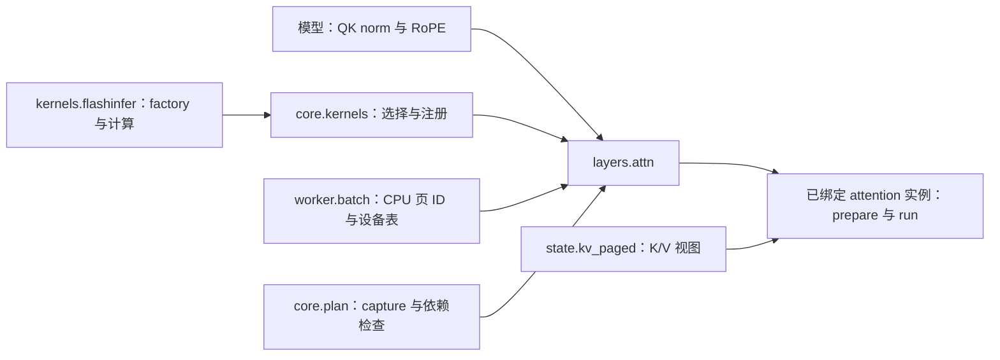

# Attention kernel 接入设计与开发计划

- 日期：2026-11-11
- 状态：设计提案；本 PR 不实现 kernel，也不代表 GPU 兼容性或性能已经验收。
- 基线：`master@ffa7254`；开发分支：`dev/gw/attn-kernel`。
- 目标：先用真实 paged decode kernel 替代按最大上下文计算的 PyTorch attention，再接入 paged extend；保留 CPU 参照、现有状态布局和引擎热更新机制。

## 1. 设计依据与范围

[modules.html](../modules.html) 是架构设计真源：层调用 definition，kernel 单元注册 solution，plan 持有 graph 并登记派生依赖。[stage2-contract.md](stage2-contract.md) §3、§5.5、§6、§8 规定共享接口、状态布局和 backend 边界。[cuda-graph.md](cuda-graph.md) 开头的「实现选择」记录已实现行为，优先于该文后面的初始方案；变更流程以 [empty-apply.md](empty-apply.md) 为准。

本分支覆盖 Qwen3.8 TP1 的 full attention：KV 写入、单 token decode、带 prefix 的 extend/prefill，以及 decode graph。首个验收目标是 SM100、BF16 Q/K/V、BF16 KV、24 个 query head、4 个 KV head、head dim 256、page size 16。小尺寸模型和其他 GPU 用于补测，不能代替 SM100 的目标配置。

GDN kernel、TP、投机 verify、SWA、MLA、量化 KV、HND、跨层池和 prefill graph 不在本次实现范围。GDN 保持现有实现参与整模型测试，因此本分支完成不等于 M2b 的全部真实 kernel 已完成。暂不改变默认 graph 开关和默认桶上限；扩大桶需要性能证据。

## 2. 当前实现与实际缺口

| 位置 | 已有行为 | 本次需要补什么 |
|---|---|---|
| [reference/unit.py](../../engine/kernels/reference/unit.py)、[ops.py](../../engine/kernels/reference/ops.py) | 定义 `kv.store@1`、`attn.decode@1`、`attn.extend@1`；attention 容差为 `atol=rtol=1e-2` | 优化实现沿用计算语义和输出 buffer；参照继续独立保留 |
| [torch_graph/ops.py](../../engine/kernels/torch_graph/ops.py) | 按 `req_to_token` 的整个宽度 gather K/V，再用长度 mask | 消除 `[batch,max_context,Hkv,D]` 的临时 KV 展开，按有效页访问 |
| [layers/attn/unit.py](../../engine/layers/attn/unit.py) | `prepare` 每步一次；`forward` 每层写 KV、调用计算；graph 元数据有 binding | 接入有 planning/workspace 的实现，不能在每层 forward 重做 planning |
| [layers/solutions.py](../../engine/layers/solutions.py) | 每阶段固定 callable；catalog version 变化后重新解析 | 保存已选 solution 及其有生命周期的调用实例 |
| [core/kernels/unit.py](../../engine/core/kernels/unit.py) | 按 shape、capability 过滤，非 reference 按 ID 字典序选第一个 | 为已选 attention solution 提供准备实例的入口，不另建选核系统 |
| [contracts/plan.py](../../engine/core/contracts/plan.py) | `Backend.prepare` 可以在 capture 外调用库的 planning；`PersistentBatch.ids` 提供 CPU 页 ID | 复用这两个入口，不添加调度消息 |
| [core/plan/graph.py](../../engine/core/plan/graph.py) | 全 padding warm-up/capture；每步先 prepare 再 replay | 验证从长度 1 的 capture 到长序列 replay 的调度有效性 |

历史测量中，4090 D、8 行、`max_context=16384` 的 graph 比 reference eager 慢，且四个桶保留约 934 MiB；这是旧实现的记录，不是新 kernel 的预期数字。见 [cuda-graph-review-fixes.md](../evaluations/cuda-graph-review-fixes.md)。

还有四个不能略过的缺口：

1. `resolve(states)` 目前只传 `head_dim`，`StateDecl` 也不含 query head 数；真实 kernel 的资格判断还需要 Q/KV dtype、head 数、页大小和设备。
2. 显式 `attn.decode_backend=flashinfer` 要求该组同时提供 `kv.store@1` 和 `attn.decode@1`；只注册后者无法启动。`attn.backend=flashinfer` 还要求 prefill 的实现。
3. kernel 单元会随 worker 自动加载。不能在模块顶层无条件 import GPU 库，使没有 FlashInfer 的 CPU 引擎无法启动。
4. `Solution.process_init` 是描述字段，不能假定填上它就会自动重启进程；native 变更必须核对现有清单和 `core.deps` 的实际规则。

## 3. 实现路线与取舍

首选移植 SGLang 的 FlashInfer paged wrapper 接入方式，限于本项目需要的 full attention 子集。首个候选为 `BatchDecodeWithPagedKVCacheWrapper`，extend 使用 `BatchPrefillWithPagedKVCacheWrapper`。SGLang 的来源基线是 [`e838360` 的 flashinfer_backend.py](https://github.com/sgl-project/sglang/blob/e838360/python/sglang/srt/layers/attention/flashinfer_backend.py)：借用 prepare/run 分离及固定 graph metadata 的组织，不复制其 speculative、SWA、量化和多种调度路径。

设计核对了 FlashInfer [`v0.6.14/decode.py`](https://github.com/flashinfer-ai/flashinfer/blob/v0.6.14/flashinfer/decode.py)、[`v0.6.14/prefill.py`](https://github.com/flashinfer-ai/flashinfer/blob/v0.6.14/flashinfer/prefill.py) 以及[官方 API](https://docs.flashinfer.ai/api/attention.html)。`v0.6.14` 是 P0 的固定候选，不是已验证的依赖选择；在线文档会随版本变化，不能拿更新版 API 直接当作候选版本的保证。P0 在仓库的 PyTorch 2.11.0 / CUDA 13.0 环境核对可安装包、实际模块和 SM100 行为，再锁定版本、wheel/hash、JIT 工具链及许可证。

| 路线 | 决定 | 原因 |
|---|---|---|
| 在现有 definition 下接入 FlashInfer solution | 首选 | 保留参照语义，复用成熟 paged kernel；重点解决准备和生命周期 |
| 直接移植 SGLang Triton decode/extend | P0 失败后的备选，需更新本文 | 更容易沿用 token-slot 表，但要重新承担 kernel 移植、性能和 graph 验证 |
| 直接接 TRT-LLM/XQA 或手写 SM100 kernel | 后续独立优化 | 先建立可验证的接入边界；架构专用路线不能绕过布局和 lifecycle 验收 |
| 每层 forward 临时创建 wrapper 并 plan | 不采用 | 重复规划、分配和 host 同步，无法满足 graph 热路径 |
| 独立 backend 服务再做一套实现选择 | 首版不采用 | 当前 catalog 已有选择与依赖跟踪；新增服务会重复两套配置和选择身份 |

## 4. 最小接口方案

### 4.1 所有权

`layers.attn` 继续提供唯一的 `layers.attn@1`，负责阶段选择、语义元数据、KV 写入顺序和输出形状。新增 `engine/kernels/flashinfer/` 单元，持有库适配代码并注册 solution。该目录是已有 `engine/kernels/` 的子集；实现时才创建，附 `unit.toml` 和移植许可证。

wrapper 实例由已选 solution 的 factory 构造，交给 backend 持有；factory 内部负责库对象、planning、workspace、事件和销毁。backend 不 import `kernels.flashinfer`，不读取 wrapper 私有字段；plan 不认识 FlashInfer。



### 4.2 准备实例通过 catalog 交接

现有 `Implementation(solution, fn)` 只交接函数，不能完整描述有状态 wrapper。提议在单元共享契约中增加一个 **attention 专用的可选 factory**，而不为所有 kernel 引入通用 runner 框架：

| 提议接口 | 语义 |
|---|---|
| `Implementation.attention_factory` | 可选；与 `fn` 二选一，登记时验证。现有 stateless 实现继续传 `fn` |
| `Catalog.select_attention(definition, spec, backend, capture=...)` | 沿用目录排序，额外调用候选的纯资格检查；返回已选 ID 与不支持原因，不分配 wrapper |
| `Catalog.bind_attention(solution, spec)` | 只绑定已选的 ID，不重新选核；返回准备实例。stateless solution 由 backend 沿用原 callable |
| `AttentionFactory.supports(spec)` | 无设备分配的资格检查；只返回 Supported 或含具体原因的 Unsupported，不能捕获任意异常充当不支持 |
| `AttentionSession.prepare(step)` | capture 外执行；接收本步 CPU 元数据，更新设备表并调用库 planning；不写 KV |
| `AttentionSession.run(...)` | 接受对应 `attn.decode@1` / `attn.extend@1` 的原计算参数，写入传入的 output；不 plan、不重新选核 |
| `AttentionSession.binding` | 按地址依赖与 generation，供 backend 合并到自身 binding |
| `AttentionSession.close()` | 幂等；等待其异步使用完成后释放所持资源，不卸载库的进程级 native module |

`Catalog.resolve` 遇到只有 factory 的实现明确拒绝，要求先绑定，不能返回会暗中 plan 的 callable。`layers.solutions.Kernels` 为 attention 保留 selected ID 并走绑定入口，GDN 和其他 stateless 调用保持原行为。`capturable=True` 对 factory 实现指绑定后的 `run`，必须有真实 GPU 测试证明。

拟新增 `core/contracts/attention.py`，只放实际跨单元交接的规格、步输入和 protocol，不 import torch；`kernels.py` 增加 factory 字段与目录入口。内部 wrapper 类型、队列、workspace 布局留在实现中。修改时同步全部消费者及 `tests/units/contracts/test_contracts.py` 的 `REACHES`，`__init__.py` 保持只有 docstring。

### 4.3 启动规格与每步输入

提议增加 `AttentionBackend.configure(specs)`：模型构造时，在 plan 的 `resolve` 之前，交出每个 full-attention 层实际使用的 `layer, num_q_heads, num_kv_heads, head_dim, q_dtype, scaling`。这些是新消费者确实需要的数据，不从权重名猜测，也不把 query 属性塞进 KV 的 `StateDecl`。模型只交声明，不创建 wrapper。

backend 将该声明与 `StateDecl`、实际 KV binding、平台信息合并，形成绑定规格：Q/KV dtype、head 数、head dim、scale、page size、设备、阶段、bucket、最大上下文和元数据容量。声明与实物不一致时启动失败。configure 必须可重复且替换整份声明；变更使旧准备实例失效，不在执行中的 forward 里重新 configure。

每步只交 `rows` 的既定顺序、CPU 物理页列表、总 KV 长度、extend 长度及真实行数。数据来自 `BatchPlan` 和 `PersistentBatch.ids("kv.paged")`，不传整个 executor、model 或 batch 私有对象。相同 head/dtype/scale 规格的层共享本步 planning；不兼容的层分组，不能用第一层的 head dim 代表所有层。

这是本设计预期新增的准备接缝。`AttentionBackend.forward`、调度记录、状态分配协议和框架本体保持原接口；旧 `attn.*@1` 的数学语义不变。另新增的 masked store 语义见 §5.3。若实现发现必须改变已有计算语义，应重新评估 definition 版本，不靠名字不变掩盖变化。

## 5. KV 布局、页表与计算语义

### 5.1 不复制 KV 的视图

现有每层 K/V 为 `[capacity + P, Hkv, D]`，`capacity=pages*P`。传库的视图为两份 `[pages+1,P,Hkv,D]`，layout 固定为 NHD；确认 contiguous、dtype 和 stride 后使用 view，不 stack K/V、不整池 gather，也不复制为 HND。page 0 是 padding。

依据[FlashInfer KV 布局说明](https://docs.flashinfer.ai/tutorials/kv_layout.html)，适配器交接压缩页表 `indptr / indices / last_page_len`。本项目的转换规定如下，须独立用 CPU 测试验证：

```text
L[r] = position[r] + num_tokens[r]
npage[r] = ceil(L[r] / P)
indptr = prefix_sum([0, npage[0], ..., npage[B-1]])
indices[indptr[r]:indptr[r+1]] = batch.ids("kv.paged")[row[r]][:npage[r]] + 1
last_page_len[r] = (L[r] - 1) % P + 1
```

账本 item `i` 对应物理 page `i+1`，不是 token slot，也不是连续页假设。总长度为 `P` 时末页长度为 `P`，不能写成 0。预留但尚未使用的页不进入 indices。检查有效行 `L>0`、页数足够、页 ID 范围、int32 不溢出；不同请求可以共享只读 prefix 页。

例：`P=16`，一行长度 17、item 为 `[7,2]`，另一行长度 16、item 为 `[4]`，则 `indptr=[0,2,3]`、`indices=[8,3,5]`、`last_page_len=[1,16]`。CPU 页表与 `req_to_token` 必须描述同一组槽位；测试故意重排和复用页来发现 off-by-one。

### 5.2 Decode 与 extend

decode 每行一个 query，先写本步 K/V，再关注该行全部 `L` 个 KV；不额外施加 query 长度为 1 的左上角三角 mask。GQA 的 head 映射与 reference 一致。

extend 构造 `qo_indptr=[0, n0, n0+n1, ...]`，其中 `nr` 为该行新 token 数；K/V 总长度仍为 prefix 加本步长度。第 `j` 个新 query 可见位置 `0..prefix+j`，采用带 prefix 偏移的 causal 语义。mixed batch 作为 extend 执行，包括其中只有一个新 token 的行；prefill 和 mixed 首版都是 eager。

Q/K norm、RoPE 已在模型层完成，库的 position encoding 设为 NONE；scale 使用模型交出的数值。不得重复 RoPE、改 scale、悄悄转换 KV 精度或改变 GQA 头映射。

### 5.3 KV store 与 padding

显式 FlashInfer backend 提供 `flashinfer.kv.store@1`。它可以是移植的 SGLang store 或本地等价的 PyTorch 写入包装，不要求品牌名下的每个操作都调用 FlashInfer；日志必须写明实际 library/entry。不得跨单元 import reference 私有实现。

`kv.store@1` 的普通调用保持原语义。graph backend 另行准备长度为 bucket 的有效行信息：真实行使用已分配的写入位置，padding 行访问 page 0、长度 1。**不能直接让多个 CUDA lane 无保护地写同一 slot 0。** 为新路径增加 `kv.store_masked@1`：参数为普通 store 的参数加设备端 `valid_rows` 标量；只写前 `valid_rows` 行，其他行完全不写。这是新增的计算语义，故有独立 definition 和 CPU reference，不静默修改 `kv.store@1`。`flashinfer.kv.store_masked@1` 作为其可捕获 solution；backend 只在新 graph 路径选择它，并把它列入 graph 的 resolved 表和依赖。

在暂停期 warm-up 前，backend 通过已有 KV binding 将 page 0 的被读位置初始化为有限值；page 0 不承载真实请求数据。每次 replay 用设备标量更新有效行数；padding attention 可读取这份初始化值，输出被丢弃。真实行的 K/V 写入与 attention 顺序不变。

capture 时真实行数为 0，不能用 Python 切片把图录成永远不写 KV。有效行数必须是固定地址的设备标量或 mask，由可捕获的写入实现运行时读取。全 padding warm-up/capture 输出须有限，真实行 replay、多个 padding lane 和长序列必须单独验证。P3 先补 mask 写入实现，再宣称 graph 支持。

## 6. 选择、配置与依赖安装

阶段性配置如下：

| 阶段 | 配置 | 必须覆盖 |
|---|---|---|
| 仅 decode 接入 | `attn.prefill_backend=reference`，`attn.decode_backend=flashinfer` | decode 和 store；prefill 仍为 reference |
| prefill 接入后 | `attn.backend=flashinfer`，阶段覆盖为空 | store、decode、extend |
| 不支持的配置 | 显式指定 FlashInfer | 启动或 apply 候选验证失败，报具体 dtype/shape/版本原因 |
| `auto` | 对已验证组合注册候选 | 按现有 catalog 规则选；没有候选使用 reference 并报告 |

`Solution.shapes` 目前只有整数值匹配。首版不扩展成通用能力表达式：单元按设备和库可用性登记，`select_attention` 按 §4.3 的完整规格调用 factory 的纯资格检查，区分支持与带原因的 Unsupported。显式 backend 无符合候选时失败；auto 跳过 Unsupported，再沿用原排序。`bind_attention` 的 import/JIT/OOM 等实际初始化异常不属于 Unsupported，不继续尝试其他候选。绑定时再次核对实际 buffer。backend 读取影响规格的配置，使依赖可追踪；kernel 单元不复制模型解析器。

为避免仅登记实验实现就改变默认行为，提议 `Solution.auto_selectable: bool = True`；新 FlashInfer solution 在 P5 验收前设为 false。两种 catalog 选择入口在 auto 时都过滤此项，显式 backend 仍可选择；测试覆盖 masked store 和普通 store，不能只限制 attention 主计算。资格支持与默认选择资格分别记录；这不是基于 benchmark 的动态排序器。

启动与 apply 候选验证必须实际运行每个已选 eager 规格的 scratch-only prepare/run，覆盖延迟 import/JIT/planning，再发布 ready；`plan.cuda_graph=off` 同样执行。使用独立的小型 K/V 测试 buffer 和确定输入，不改真实请求的页；容量相关检查按实际配置做。该探测由 backend resolve/bind 阶段组织，不因此提前分配 graph 专用 workspace。测试注入 eager planning 失败，要求启动失败或候选撤回，而不是等第一个请求报错。

CPU、未安装可选库或不在已验证设备范围时，不登记 FlashInfer solution；显式选择仍须失败。库已被选中后的 import、JIT、plan、capture 或数值错误必须暴露，不能 catch-all 后静默换 reference。日志至少包含阶段、solution ID、外部库版本、内部 kernel backend、dtype/head/page 规格、capture 能力和 fallback 原因；`flashinfer` 这个名字本身不代表一定采用了 SM100 专用实现。

P0 通过后再增加 Linux GPU 的可选依赖和锁文件；CPU 安装不携带 FlashInfer。先在远程专用环境完成依赖安装和 JIT 预热，再启动引擎；JIT 不发生在 capture 中。依赖/native ABI 改变按部署及现有进程重启规则处理，不能仅修改 `Solution.library` 就声称加载了新二进制。当前 PR 只写设计，不改依赖。

## 7. Graph、overlap 与资源生命周期

### 7.1 一个阶段或桶一个准备实例

eager decode、eager prefill、每个 graph bucket 使用独立准备实例；相同规格的层复用该实例的 planning。graph 的页表按容量预分配：bucket 为 `B`、最大上下文为 `C` 时，indices 上界为 `B*ceil(C/P)`，包括 padding 所占一页。只更新有效前缀，尾部不可被 kernel 当成有效页读取。

FlashInfer 的 planning 在 capture 外执行，`run` 才进入图。固定 batch size 不足以证明 graph 安全：必须用真实序列增长、跨页、不同长短分布以及 split-K 调度边界，验证已捕获 launch 和辅助表仍然适用。不能假定 `fixed_split_size` 自动解决这些问题；候选版本的文档也提示其 graph 兼容性有限。P0/P2 固定并记录实际内部 backend、tensor-core/split 策略，不在 replay 中重新选择算法。

backend 的 graph binding 只汇总 **graph 准备实例** 的按地址依赖，包括库持有的 device workspace；eager 实例独立管理，其 re-plan 或 buffer 替换不改变 graph generation。同地址更新内容不增 generation，graph buffer 的地址/shape/stride/dtype 或解释变化则增。若 wrapper 会在 re-plan 时更换隐藏 buffer，必须修正适配或将该组合标为不可捕获，不能仅登记公开的三张页表。执行路径不能在 graph 建成后按需扩容 workspace；测试 prefill eager → decode graph 后图仍 ready。

### 7.2 同 stream 与 host staging

顺序为：batch/state copy → backend prepare 的设备更新 → KV store → attention/replay → sampling/state copy。全部设备工作沿现有 step stream 排队。首版不引入额外 metadata stream；若库内部使用其他 stream，P0 必须查明并建立事件依赖。

CPU 可以准备下一步，但固定 device 表只能通过排在前一步之后的 stream 操作更新。pinned host 源和库内部 planning 暂存区也不能在异步 H2D 完成前被 CPU 覆盖。适配器保留 staging 的所有权到 copy 完成事件；可替换的 host staging 用轮转槽，不可替换的库内 staging 在下一次复用前等待上次上传事件。这个等待只保护上传，不在每步强制同步整个模型 forward；若库实际上强制全流同步，要如实计入性能并限制 overlap 承诺。

候选 `v0.6.14` 的 decode graph 路径对 CPU indices 明确使用阻塞拷贝。因此先从 pinned host indices 异步上传到固定 device staging，再把 device indices 传给 wrapper.plan；CPU indptr/last-page-length 保留用于 host planning，避免 D2H。库内部是否还同步由 P0 验证。overlap 验收需证明第二步 submit 返回时，故意延迟的前一步 forward 仍未完成，不能只比较最终输出。

不要仅凭 device 地址不变就复用 workspace。不同桶、eager/graph 交替以及 prepare 连续提交的生命周期都纳入 GPU 测试。

### 7.3 显存与释放

图专用 wrapper、固定页表和 workspace 在 `core.plan.record` 的预算采样之后、capture 之前创建，纳入现有 `plan.graph_memory_bytes` 的增量；eager 实例单独报告常驻内存。库若使用 PyTorch allocator 之外的分配，不能仅用 `memory_reserved` 计费，须额外记录并核对设备空闲显存。不得为了录图静默缩小已发布的 KV/GDN 容量。

先关闭 graph，再调用 backend `release_graphs` 关闭对应准备实例；eager 实例在 backend 卸载或重新解析时关闭。构造到一半失败也要清理，close 幂等。初版每桶独立 workspace，先保证生命周期；确认库只把某部分当 scratch 且所有使用有序后再讨论共享，避免重现多次 apply 的显存增长。

`plan.cuda_graph=auto` 仍只对已定义的不可捕获或资源不足原因降级 eager；`required` 失败。选中的 kernel 执行错误或数值不对不属于可降级理由。

## 8. 热更新与远程测试的源码身份

沿用 `core.plan` 的 `ctx.derived` 和 catalog sources/version：新增、替换、删除 kernel 注册都必须触发相关 plan 重载；不新增 `rebuild_graphs` action。后端重建准备实例后再录图，旧实例不能留在 Python 全局缓存中。plan 的关闭顺序必须先于这些资源释放。

catalog version 变化的处理提前到 resolve/prepare，不能在某一层 forward 中临时换 session。即使 backend 单元未重载，plan 重载调用 resolve 时也要关闭并重建其旧准备实例。正常发布在暂停期完成；未经过该流程的目录变化由已有 graph 守卫拒绝，eager 也不得调用只绑定、尚未 prepare 的新实例。

测试一次真实代码行为变化，不能只改注释：dry-run 核对 kernel/backend/plan 的受影响集合，apply 后确认调用新 solution，输出与同源码冷启动一致。另测候选 planning 失败和显式 backend 被删除的撤回；确认旧 solution 与 wrapper 可恢复、服务可继续，且旧 graph 在状态写入前被拒绝。graph OOM 分两种验收：`required` 撤回并恢复旧配置；`auto` 清理候选 graph 资源后允许提交，但所选 eager 实现必须可用且日志明确记录降级。

非 live 变更在空引擎上执行；有请求时默认拒绝，测试需要排空则使用 `--wait-empty`。机制异常写入 `doc/framework-bugs/`，无法继续热改才重启并记录。新增依赖或 native module 的安装与进程重启先单独完成，再验证 Python 包装代码的热改。

远程 GPU 测试只使用本分支的独立源码目录：

1. 已提交版本：推送 `dev/gw/attn-kernel`，远程取明确的 commit SHA，在独立 worktree checkout；记录 SHA、dirty 状态、锁文件和环境版本。
2. 未提交版本：从本地 `attn-kernel` worktree 同步到独立远程工作目录，保留目录外的模型和虚拟环境；排除 `.git`、`.venv`、运行快照和测试生成物。记录基线 SHA、差异及同步源码摘要，包含新文件。不得覆盖其他分支的工作目录。
3. 引擎 `--source` 指向该远程目录。复制文件后执行 `check → apply --dry-run → apply`，核对 active identity、resolved solutions 和 graph 重录后才测；只复制文件不证明运行的是新代码。
4. 保存命令、配置、GPU/driver/CUDA/torch/FlashInfer 信息、原始结果及日志路径。设计阶段不要求远程机器；P0 才需要具体 GPU 环境。

## 9. 验收矩阵与性能口径

| 层次 | 必测内容 | 通过条件 |
|---|---|---|
| CPU 元数据 | 长度 1、P-1/P/P+1、最大上下文、非连续页、共享 prefix、行重排、预留页、padding、非法 ID | 与 token-slot 表对应，越界在写 KV 前被拒绝 |
| CPU 接口 | configure/resolve/bind/prepare/run/close 次序；多个 head 规格；显式缺失 store；没有 GPU 库 | 错误在启动/候选验证时暴露，stateless/GDN 路径不退化 |
| GPU 算子 | BF16 目标形状；MHA/GQA；不同 batch/长度；decode、带 prefix extend、mixed；KV 写入与未写区域 | 对独立 reference 比较输出和 KV，拒绝 NaN/Inf，不误写共享页 |
| GPU graph | 实际 `CUDAGraph.replay`；全 padding capture 后真实行；桶切换；跨页和长序列；页重排 | 不冻结 metadata，不跑 eager 冒充 replay，padding 无写冲突 |
| GPU overlap | 深度 1/2；推迟前一步完成；连续 prepare；eager/graph 交替 | 输出、页内容相容，无 staging 提前复用；记录 host 同步影响 |
| 热更新 | 新增/替换/删除 solution，失败撤回，连续 10 次变更，冷启动对照 | 新实现可观测，旧图失效，状态容量不变，内存/资源不持续增长 |
| 模型与服务 | 小模型、真实结构前 4 层、SM100 完整权重，经 HTTP | 按下述数值口径对齐；小模型不能替代全模型验收 |

算子比较首先使用相同 BF16 输入的 FP32 reference，沿用 attention definition 的 `1e-2/1e-2` 容差，记录最大绝对/相对误差、失败元素和随机种子；不能因 token 流允许 BF16 分歧而跳过 kernel 正确性。阈值不够时先定位误差，不直接放宽。KV store 在无需转换的目标配置下要求精确，受保护的 prefix/未写区域必须精确不变。

完整模型遵循 stage2-contract §1.3：FP32 参照链路保留，BF16 token 分歧记录但不单独判失败；数值、索引、状态污染仍判失败。用同一输入历史做 teacher-forced logits 对照，避免生成分叉后比较不同输入。greedy 仅在 top-1/top-2 间隔足够时要求一致。当前 `Definition.batch_invariant=True` 的解释与已允许的批次舍入差异存在张力：P0/P1 必须记录优化实现的批次重排结果，若不保证 bitwise，随接口提交澄清该字段的承诺，不能沿用参照的声明声称新实现逐位不变。

新增测试放现有 `tests/units/kernels/`、`tests/units/executors/` 和 `tests/gpu/`。CPU 替身只验证协议，不能证明 GPU 性能或捕获能力；GPU 文件继续显式执行，不通过自动 skip/xfail 掩盖缺少环境。按仓库要求声明 `covers` 并作实际断言。

性能分开报告三层：纯 attention GPU 时间；prepare + store + attention 的完整层调用；worker/HTTP 端到端。至少对比 reference eager、torch_graph、FlashInfer eager、FlashInfer graph。同一测试内固定输入轨迹、dtype、状态容量、实际长度、batch 和 overlap，仅改变被比较项；安装/JIT、权重加载、capture 和预热不混入稳态时间，另报告启动和重录成本。

建议 batch 1/4/8/16/32，实际长度 32/256/4096/16384，另设不小于实际长度的不同 `max_context`。报告中位数、尾延迟、吞吐、host prepare 时间、device 时间及 allocated/reserved/device-free 显存。固定实际长度而增大容量时，新 attention 不应出现按容量 gather 全 KV 的计算和临时 tensor；元数据预留本身可以随容量增长。性能不写入普通 pytest 时间阈值，也不预先承诺加速倍数。若默认组合退化，保留显式实验路径并解释原因，再决定是否允许 auto 选中。

## 10. 分步实现与合并条件

| 步骤 | 具体产物 | 进入下一步的条件 |
|---|---|---|
| P0 兼容性探针 | 目标 GPU 上候选库的 eager、长度变化 graph、页视图、planning/staging/JIT 探针；带日期评估记录 | 锁定可运行版本与内部 backend；确认 24/4/256、P16、BF16；未通过则更新选型，不编造支持表 |
| P1 最小准备接缝 | attention 专用 factory/protocol、模型 configure、catalog 绑定、后端 ownership、CPU 测试 | stateless 与 GDN 回归通过；清单/import/REACHES 正确；关闭和失败清理有断言 |
| P2 Decode eager | `kernels.flashinfer`、页表转换、store、显式 decode 配置和启动检查 | GPU 算子及真实层对齐，热改行为与冷启动一致；暂不标 capturable |
| P3 Decode graph | 固定 bucket 实例、masked padding store、绑定依赖、预算和 overlap | 实际 replay、长序列调度、资源释放、10 次 apply/撤回验收；之后才声明 capturable |
| P4 Extend | paged prefill、prefix causal、mixed、阶段组合 | 无 prefix/共享 prefix/chunked prefill 对齐；全 backend 显式配置可用 |
| P5 集成与评估 | SM100 完整模型/HTTP、benchmark、默认选择结论及复现记录 | 数值/状态/热改均通过，性能证据可追溯；明确剩余 GDN 工作 |

预计改动集中于 `engine/kernels/flashinfer/`、`layers/attn/`、`layers/solutions.py`、`core/kernels/`、少量 `core/contracts/` 与模型声明；reference 单元补 masked store 的定义和参照，必要时补 `core.plan` 的资源收集/日志。它们不属于 `engine/framework.toml` 的框架本体。部署补 attention backend 配置透传，测试显式选择目标 solution，避免 auto 恰好选到别的实现。新增目录时同步 skill 地图。

每个实现提交前运行 `uv run pyright`、`uv run pytest -n 8`；GPU 用 `uv run --extra gpu pytest tests/gpu/<对应文件>` 在已锁定的 GPU 环境显式执行。若实际改到 AGENTS.md 列出的 formal 触发项，再跑 formal 全流程；本方案不预期需要这些改动。依赖/锁文件变动会触发额外框架 CI，应如实计入验证范围。

优先评审的决定是：保留现有 definition 与 KV 布局、增加 attention 专用准备接缝、CPU 页表来源、padding 的无冲突写入、wrapper 的异步生命周期。版本、split 策略和 workspace 大小由 P0 的可复现实验确定；这些未决项不影响先评审所有权与交接边界。
